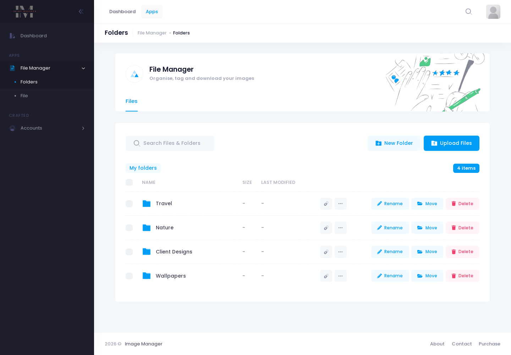
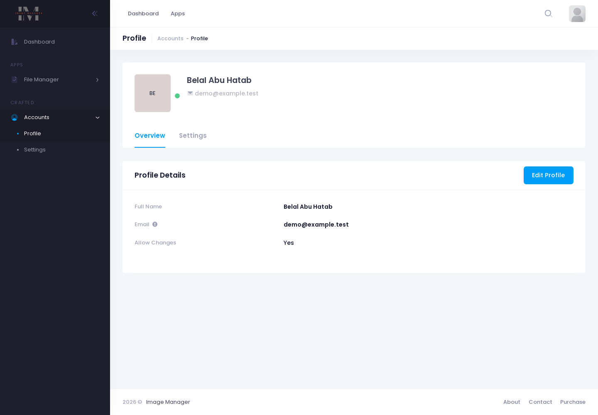

# Image Manager: Front End

Angular front end for Image Manager. The API lives in [image-manager-api](https://github.com/belalyasin/image-manager-api).


## What is in it

- Authentication: login, registration, forgot password, route guard
- File manager: browse folders and the images inside them
- Account and profile pages

The layout and base components come from the Metronic 8 Angular template.

| Folders | Profile |
| --- | --- |
|  |  |

## Tech stack

Angular 12, TypeScript, Angular Material, ng-bootstrap, RxJS

## Getting started

Start the API first, then:

```bash
git clone https://github.com/belalyasin/image-manager-frontend.git
cd image-manager-frontend
npm install --legacy-peer-deps
npm start
```

Then open http://localhost:4200. The API address is set in `src/environments/environment.ts` (`apiUrl`, default `http://localhost:3000/api/v1`).

On Node 17 or newer, Angular 12's build needs `export NODE_OPTIONS=--openssl-legacy-provider`.
